<a href="https://rishinalem.com">
  <picture>
    <source media="(prefers-color-scheme: dark)" srcset="assets/header-dark.svg">
    
  </picture>
</a>

I’m Rishi (Pranay Rishi Nalem), a high school senior in California who does machine learning research. I study what finetuning changes inside a model, how agents can imagine a screen before they act on it, and how to check the work AI produces. I also build things people use: [SattvaAI](https://sattva-ai-website.vercel.app/), a private agent that runs the apps on your computer, and [Nalem Study Circle](https://nalemstudycircle.org), a free learning platform that has served 2,400+ students in 12 countries.

**Now**

- Leading research on formal verification and LLM theorem proving in Lean 4, in an industry–academic collaboration with Capital One.
- Writing up two world-model manuscripts for computer-use agents (tentatively ICLR 2027) and SpinRC-Bench, a benchmark for spintronic reservoir computing.
- Building SattvaAI.

## Research

| Project | Where | When | What came out of it |
| --- | --- | --- | --- |
| Formal verification and LLM theorem proving | Capital One collaboration, research lead | 2026– | Benchmarking proof verifiers for AI-generated math; a generate, verify, iterate loop for proofs in information theory |
| World models for computer-use agents | George Washington University | 2026 | Latent and text-space world models: +0.203 on AgentNet-Ubuntu multi-step prediction, 94% goal grounding, usable horizon from ~4 to ~8 steps |
| Masked diffusion models | Yale University | 2026 | Cutting the training cost of adaptive masked diffusion while keeping any-order decoding |
| Weak RF fields and cancer-cell biophysics | University of Colorado Boulder | 2026 | Protein-graph noise screening; only 12 of 326 interior residues measurably affect the FAD site |
| CubeSat formation control | Student team, first author | 2026 | Accepted at AAS/AIAA 2026; a model fix cut eight-orbit disagreement from ~182–185 m to 14–20 m |
| Magnon dynamics in CrSBr | UC San Diego | 2026 | Physics-informed ML that classifies magnon propagation and extracts wave equations from video |
| MonoScan | University of Notre Dame | 2026 | Computer vision that finds WSe₂ monolayers in microscopy images, now used in the lab’s pipeline |
| Spintronic reservoir computing | Independent | 2025–26 | 500+ OOMMF simulations; first place at the county science fair |
| Task matrices | Algoverse AI Research | 2025 | One linear map from base to finetuned embeddings; NeurIPS 2025 UniReps workshop poster |

**Papers**

1. *Testing Chaos-Assisted Passive Reconfiguration: Relative-Motion Validation, Invariant Maps, and Fair Differential-Drag Comparison.* First author. 2026 AAS/AIAA Astrodynamics Specialist Conference, AAS 26-1032. [DOI](https://doi.org/10.5281/zenodo.23369472)
2. *Task Matrices: Linear Maps for Cross-Model Finetuning Transfer across Modalities.* Co-author. NeurIPS 2025 UniReps Workshop. [OpenReview](https://openreview.net/forum?id=wCm3TFLNwr)

For fun: [*On the Active Rheology of Cats*](assets/active-rheology-of-cats.pdf), a mathematical satire that adds an escape number to the old question of whether cats are liquid. There’s an [interactive version](https://rishinalem.com/#cats) on my site.

## Building

- **[SattvaAI](https://sattva-ai-website.vercel.app/)**. Describe a task in plain language and it carries out the steps on screen, across any app, entirely on your machine.
- **[Nalem Study Circle](https://nalemstudycircle.org)**. Turns a student’s goal into a personalized path, with an AI focus manager and a peer circle for accountability. Conrad Innovator, Conrad Challenge.

**Hackathon builds.** MemoryMesh (Cal Hacks 12.0), an AI co-pilot for people living with Alzheimer’s. WayFinder AI (LA Hacks 2025). SpeakScribe (PennApps). Five wins in twenty hackathons.

**Earlier builds, each with a video.** [AI-powered robot arm](https://www.youtube.com/watch?v=CBZo3_qBZF0), [voice-controlled Pong](https://www.youtube.com/watch?v=ODQWSnVnlJk), [GitHub FAQ bot](https://www.youtube.com/watch?v=w79sVJ-q-Tc), [micro:bit Caesar cipher](https://www.youtube.com/watch?v=bIt3S9f6cc0), [Dillman’s Antiquities app](https://www.youtube.com/watch?v=5Q0CJFjN8Tc).

<table>
<tr>
<td valign="top" width="50%">

**Latest writing**

<!-- medium starts -->
- [All posts on Medium](https://medium.com/@pranayrishi.nalem)
<!-- medium ends -->

</td>
<td valign="top" width="50%">

**Latest videos**

<!-- youtube starts -->
- [All videos on YouTube](https://www.youtube.com/@programmingwithrishinalem)
<!-- youtube ends -->

</td>
</tr>
</table>

## Tools

**Formal methods:** Lean 4 and Mathlib, LLM-guided proof search. **Machine learning:** PyTorch, TensorFlow, scikit-learn, LoRA, diffusion transformers, world models, reinforcement learning, vision-language models. **Scientific computing:** OOMMF, SciPy, NumPy, spectral graph analysis, ODE and hybrid-system simulation, ROS 2. **Languages:** Python, C++, C, JavaScript, MATLAB, Dart.

## Elsewhere

[rishinalem.com](https://rishinalem.com) · [LinkedIn](https://www.linkedin.com/in/rishi-nalem-8161b7244/) · [YouTube](https://www.youtube.com/@programmingwithrishinalem) · [Medium](https://medium.com/@pranayrishi.nalem) · pranayrishi.nalem@gmail.com

The writing and video lists above update themselves daily through a GitHub Action.
